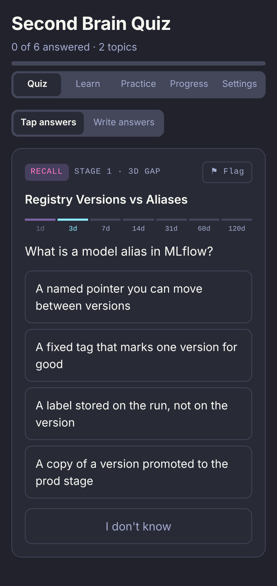
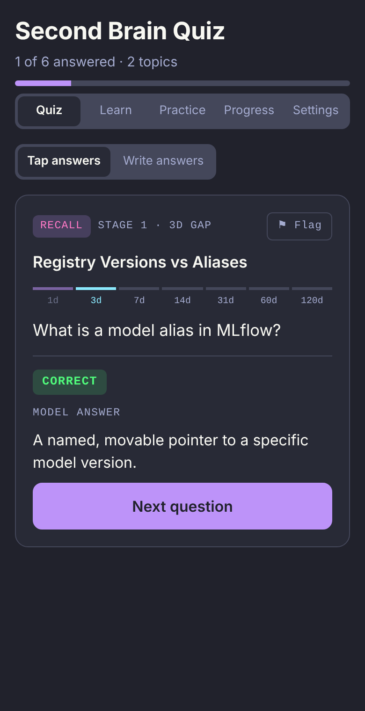
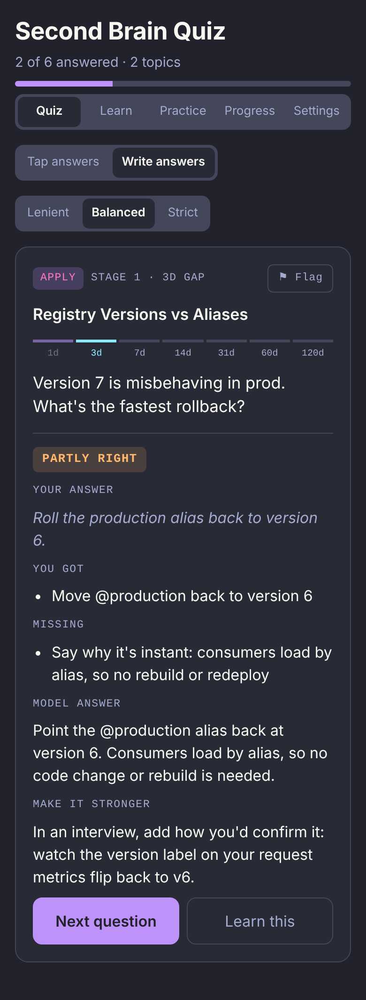
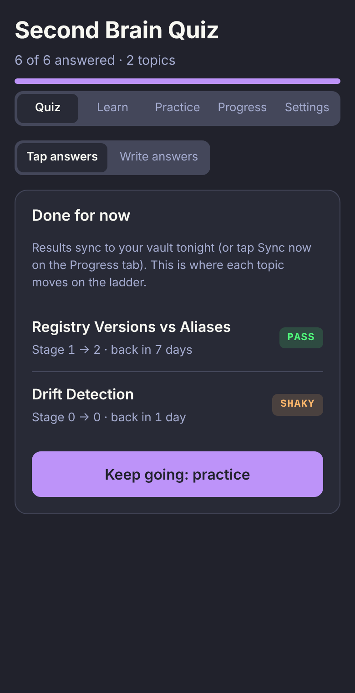
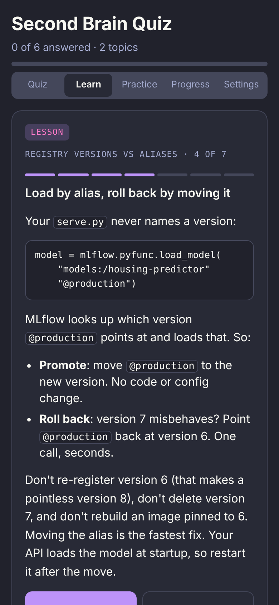
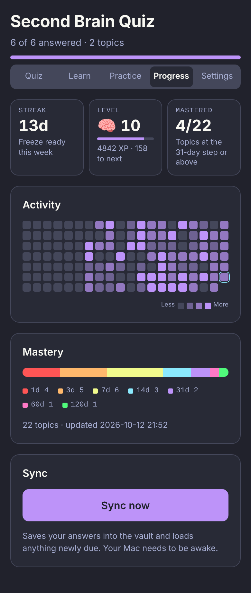
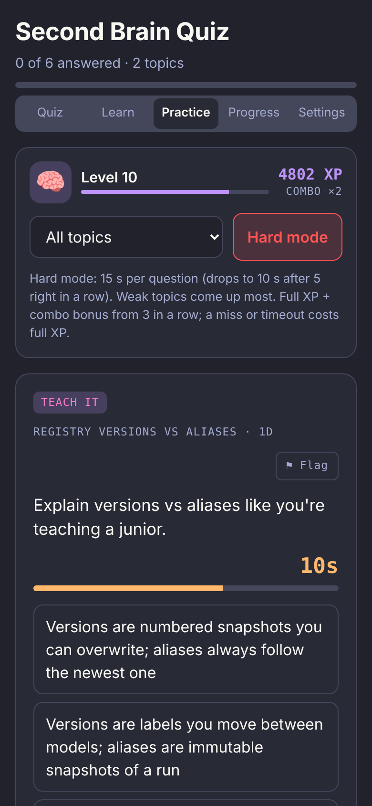
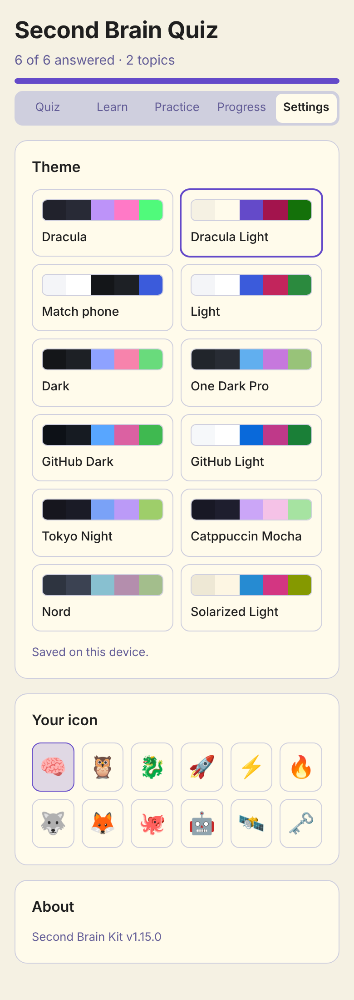

# Second Brain Kit

A learning system that stops you forgetting what you learn. Claude keeps your notes in Obsidian, quizzes you on your phone on a spaced-repetition schedule, and puts reminders in your calendar.

Built on Karpathy's "LLM wiki" idea and the CoderCo *Learn it so it sticks* method: recall first, explain it like you're teaching, review on days 1 · 3 · 7 · 14 · 31.

> **Install:** open a Claude Cowork task linked to your computer and say *"Set up https://github.com/smir22/second-brain-kit for me"*. Already set up? Type **`/update-second-brain`**.
>
> **Claude, reading this for a user:** to install, follow [`SETUP_PROMPT.md`](SETUP_PROMPT.md) step by step. If they already have a Second Brain vault (a `CLAUDE.md` with this schema or a `.sync/kit_version`), follow [`skills/update-second-brain/SKILL.md`](skills/update-second-brain/SKILL.md) instead.

**What you get**
- **Quiz:** tomorrow's due topics on your phone, multiple choice (or written answers marked by Claude), with code snippets where a question needs them. Works offline and lets you flag bad questions.
- **Learn:** your weak topics as step-by-step lessons (the problem, the idea, your own code line by line, your past mistakes), then 2 right in a row to clear.
- **Practice:** endless questions from your whole bank, XP, combos and a timed hard mode.
- **Progress:** streak, levels, a GitHub-style heatmap and mastery across the ladder.
- **Settings:** 12 themes and your own icon.
- **On your Mac:** `/ingest` after you learn something, `import` for older material, a nightly sync that moves topics up the ladder, calendar reminders, and `/update-second-brain` for new versions.

<p align="center">
  
  
  
  
</p>
<p align="center">
  
  
  
  
</p>
<p align="center"><sub>Quiz: tap answers · feedback · written answers marked by Claude · where each topic moves next<br>Learn lesson · Progress · Practice (hard mode) · Settings (example data)</sub></p>

---

## How it works

```
learn something ──► /ingest (Mac, Claude Cowork; typing or voice)
                      • brain-dump what you remember
                      • Claude finds your gaps and drills you on them
                      • writes notes, a step-by-step lesson and a bank of
                        quiz questions into Obsidian
                              │
evening sync (auto) ──► loads tomorrow's questions onto your quiz page
                      • adds an 08:00 "Quiz: …" calendar event
                              │
commute (phone) ──► tap through the quiz (or write answers, marked by Claude)
                              │
next sync (auto) ──► scores each topic, moves it up/down the ladder,
                     saves weak spots + log in Obsidian
```

**The ladder.** Pass → next step. Shaky → same step again. Fail → back to day 1.

| Step | 0 | 1 | 2 | 3 | 4 | 5 | 6 |
|---|---|---|---|---|---|---|---|
| Next review in | 1d | 3d | 7d | 14d | 31d | 60d | 120d |

---

## Setup (≈10 min)

**You need:** the Claude desktop app with Cowork, on a Mac (Windows untested), linked to your computer. Optional: the Google Calendar connector for reminders.

1. Open a new Cowork task linked to your computer.
2. Say *"Set up https://github.com/smir22/second-brain-kit for me"* (or paste the prompt from [`SETUP_PROMPT.md`](SETUP_PROMPT.md), which is what Claude follows).
3. Answer its questions. It installs Obsidian if needed, builds your vault, publishes your quiz page, schedules the sync and installs `/ingest` and `/update-second-brain`.

---

## Using it

### Already learned a lot? (Mac)
- Say **`import ~/path/to/course-or-project`**. Claude scans it, proposes a topic list, you rate each one, and it writes notes + quiz questions. New topics are staggered (max 3 a day) so your phone quiz never floods.
- Anything that comes up later in a vault session without a page: Claude asks "Add X to your quiz?".

### After you learn something (Mac)
- In Cowork say **`/ingest`** (or "I just learned X"). Typing, dictation and voice mode all work.
- **Dump** everything you remember first. Messy is fine. Where you stall is your gap.
- **Drill:** Claude takes your gaps one at a time: asks a guiding question, explains if you're stuck, then you explain it back like you're teaching a junior.
- **Notes, lesson + questions:** it writes the topic page, a step-by-step lesson for the Learn tab, your weak spots and a question bank (the first questions target what's still shaky).
- Your first review is tomorrow.

### Quiz (phone)
- **Open it:** tap the link in the 08:00 calendar event, or the pinned page in the Claude app sidebar. Tip: open it in Safari (signed in to claude.ai) → Share → **Add to Home Screen** for one-tap access, like an app.
- **Tap answers (default):** every question is multiple choice. No typing, works one-handed.
- **Write answers (optional):** switch at the top. Why / apply / teach questions become a text box: type, or tap the keyboard mic and talk. Claude marks it and shows what you got, what's missing, the model answer and a tip.
- **First written answer:** the page asks permission to use Claude for marking. Allow it (it uses your normal Claude usage; multiple choice uses none).
- **Strictness:** Lenient / Balanced / Strict (shows in Write mode).
- **Done screen:** shows where each topic moves on the ladder.
- Nothing to do? It says so. New questions load at the next sync.
- **⚑ Flag** any bad question (wrong answer, unclear, needs code, too easy). It's logged on the topic's page and fixed next time you say `refresh banks`.
- **No signal?** Keep going. Answers are saved on your phone and sent when signal returns. Open the quiz once before you go underground.

### Learn tab (phone)
- Lists your weak topics (stage 0–1, missed questions, logged weak spots), most urgent first.
- Tap one for a **step-by-step lesson** (4–7 short screens): the problem it solves, the idea in plain words, your own code explained line by line, the gotchas you've hit before, and a recap. Claude writes it once per topic into the page's `## Lesson`; reading it costs no tokens.
- **Test me** → questions on that topic. Get **2 right in a row** to clear it; a miss shows why and sends you back to the lesson.
- Missing a question in Quiz or Practice shows a **Learn this** button that opens that topic's lesson.
- Learn never moves the ladder (only Quiz does); misses still become weak spots.
- Older vault without lessons? Say **write lessons** in a vault session.

### Practice tab (phone)
- **One question at a time** from your whole bank, as many as you like, with a smooth swap to the next. Weaker topics come up more often; filter to shaky topics or one topic.
- Right: green glow, XP floats up, next question slides in. Wrong: quick shake, the right answer is shown, tap Next.
- **Normal:** half XP (+1 even for a miss).
- **Hard mode:** **15 seconds** per question, dropping to **10 seconds** once you get 5 right in a row (back to 15 after a miss), with a live countdown. Weak topics and questions you've missed before come up much more often. Full XP plus a combo bonus from 3 in a row; a miss or timeout costs the full XP value.
- Answer options are shuffled every time (Quiz and Practice), so you can't memorise positions.
- Counts for your streak; misses are saved as weak spots. It never moves topics on the ladder, so your review schedule stays honest.
- Pick **your icon** in Settings; it shows next to your level.

### Progress tab (phone)
- **Streak:** days in a row you answered (or opened the quiz when nothing was due). One missed day a week is covered by an automatic freeze.
- **Level & XP:** correct 10, partly 5, wrong 2 (for showing up), multiplied by the topic's ladder step, so remembering something after 31 days is worth more than after 1.
- **Activity heatmap:** last 20 weeks, GitHub style.
- **Mastery:** how many topics sit at each step of the ladder. "Mastered" = 31 days or more. This is the number that actually means you've learned it.
- **Sync now:** saves your answers into the vault straight away instead of waiting for the schedule (your Mac needs to be awake). The first tap asks permission to use the Claude Code Remote connector.

### Settings tab (phone)
- **Theme:** Dracula (default), Dracula Light, Match phone, Light, Dark, One Dark Pro, GitHub Dark/Light, Tokyo Night, Catppuccin Mocha, Nord, Solarized Light. Saved per device.

### Notes (Mac, Obsidian)
- Open Obsidian → your vault. Each topic page shows its stage, next review date and **Weak spots**.
- Write your own thoughts under **My notes**. Claude never edits that section.
- `log.md` = history of everything that happened.

### Other things to say in Cowork
| Say | What happens |
|---|---|
| `import <folder or project>` | Bulk-add things you already learned (course repo, notes). Claude proposes topics, you rate them know / shaky / skip, new ones roll in 3 a day |
| `process inbox` | Same, for files you dropped into `raw/inbox/` |
| `refresh banks` | Writes fresh questions for topics whose question bank is used up |
| `quiz me` | Quiz in chat instead of the phone |
| `plan a build for X` / `build done` | Hands-on lab; at the end you explain your code line by line |
| `plan week` | Fits reviews and builds around your schedule |
| `anki export` | Facts (ports, flags, vocab) → file you import into Anki |
| `lint the wiki` | Monthly tidy: broken links, gaps, contradictions |

### Sync
- Runs once a night by itself (default 20:52): saves your quiz results into the vault, loads tomorrow's questions, and adds a calendar reminder naming tomorrow's topics.
- All the logic is in `.sync/sync.py` (no AI tokens); the scheduled task only moves data. Once a run has worked, switch the task's model to **Haiku** in its settings to keep it cheap.
- Want it sooner? Tap **Sync now** on the Progress tab.
- Your Mac needs to be on and awake at sync time. If it's asleep, tap Sync now later or the next night's run catches up. Nothing is lost.

---

## Updating

Your quiz page doesn't update itself when this repo changes. In a Cowork task linked to your computer, type **`/update-second-brain`**. It pulls the latest kit, shows what's new since your version, updates the sync script, rules and quiz page **at the same link**, and runs any one-time steps you missed. Your notes, scores and history are kept.

No skill yet (set up before v1.14)? Paste [`UPDATE_PROMPT.md`](UPDATE_PROMPT.md) once; it installs the skill. Your version is under **Settings → About**; see [`CHANGELOG.md`](CHANGELOG.md) for what's new.

## Improving it with Claude

Open a Cowork task, connect your vault folder and say:
> Read CLAUDE.md in my vault. I want to change: …

`CLAUDE.md` holds every rule, so Claude has the full picture. `.sync/sync.py` is the scoring/scheduling logic, with a self-test (`python3 .sync/test_sync.py`) to run after any change.

---

## Troubleshooting

| Problem | Fix |
|---|---|
| Quiz page empty | Nothing due yet, or the sync hasn't run. Run the scheduled task manually from the Claude app. |
| Sync run says it can't find the vault | Add your vault folder in the scheduled task's settings. |
| No calendar event | Connect Google Calendar in Claude, or check the event isn't on a different calendar. |
| Calendar event shows in Google Calendar but not on iPhone | iPhone Settings → Apps → Calendar → Calendar Accounts → add the same Google account and turn Calendars on. |
| Practice tab says no question bank yet | Run the sync once (Sync now), or say "publish banks for practice" in a vault session. |
| Missing a feature from the README | You're on an older version. See **Updating** above. |
| Questions show a text box | You're in Write answers mode. Tap **Tap answers** at the top. |
| Marking feels harsh | Write mode only: switch to Lenient. |

---

Credits: [Karpathy's LLM wiki idea](https://x.com/karpathy) · [obsidian-llm-brain](https://github.com/Husseinmalki/obsidian-llm-brain) · CoderCo *Learn it so it sticks*. MIT licence.
